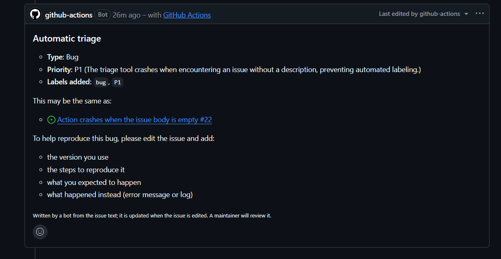
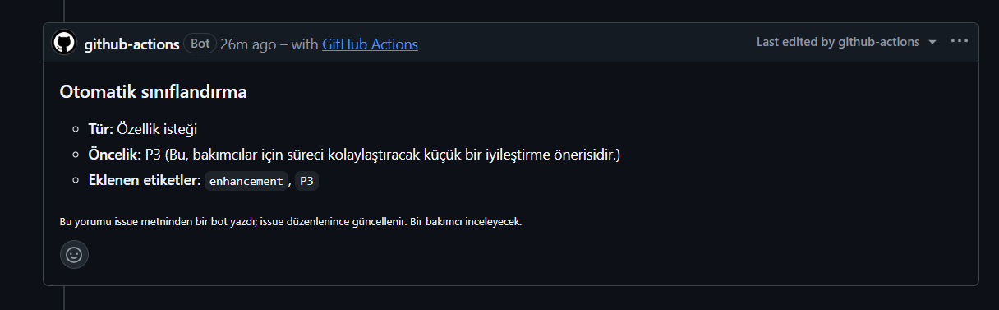

English | [Türkçe](README.tr.md)

# Issue Triage Action

A GitHub Action that triages new issues automatically with an LLM. It labels each issue by type and priority with the repository's own labels, finds possible duplicates, asks the author for missing bug details, and writes everything as one short comment. It runs on a free Gemini API key and also works with any OpenAI-compatible provider (Groq, OpenAI, a local Ollama).

## Features

- **Type:** bug, feature request, question or documentation.
- **Priority:** P0-P3 with a one-sentence reason.
- **Labels from your repository only:** the action never creates labels. Type and priority are matched to labels you already have (`bug`, `enhancement`, `Type: Bug`, `priority/P1` and similar spellings all work), and the model can pick other fitting labels from your list.
- **Duplicate detection:** the new issue is compared with the 100 most recently updated issues (open and closed) by embedding similarity; the model then keeps only the ones that report the same problem. Without an embedding model, it falls back to recent issue titles.
- **Missing details:** for bug reports without a version, steps to reproduce, expected or actual result, the comment asks the author to add them.
- **One comment, kept up to date:** when the issue is edited, the same comment is updated instead of adding a new one.
- **Comment in the issue's language:** Turkish issues get a Turkish comment, everything else English.
- **Respects maintainers:** issues that a person has already labelled are skipped. The action only removes labels it added itself, and if a maintainer removes one of its labels, it never adds it back.
- **Never blocks your issues:** provider outages and rate limits end the run with a warning; only a wrong setting (bad key, model name or input) fails it.
- **Dry run:** shows the labels and the full comment in the log without writing anything.

## Screenshots

A bug report: labels, priority, a possible duplicate and the missing details.



A Turkish feature request gets a Turkish comment.



## Tech Stack

| | |
|---|---|
| TypeScript, JavaScript Action on Node | Starts in seconds and runs on every runner OS, unlike a Docker action |
| @actions/core, @actions/github | Inputs, outputs, logs and an authenticated REST client |
| OpenAI-compatible API, Gemini by default | Free tier with chat and embeddings; the same request works with other providers |
| zod | Validates the model's JSON answer at runtime |
| esbuild | Bundles the action into a single `dist/index.js` |
| Vitest | Unit and end-to-end tests with fake GitHub and model clients |

## Installation

1. Create a free API key in [Google AI Studio](https://aistudio.google.com/apikey).
2. Add it to your repository as a secret named `GEMINI_API_KEY` (Settings → Secrets and variables → Actions, or `gh secret set GEMINI_API_KEY`).
3. Add `.github/workflows/triage.yml`:

```yaml
name: Issue triage

on:
  issues:
    types: [opened, edited, reopened]

permissions:
  contents: read
  issues: write

concurrency:
  group: triage-${{ github.event.issue.number }}

jobs:
  triage:
    runs-on: ubuntu-latest
    steps:
      - uses: MrcDprm/issue-triage-action@v1
        with:
          api-key: ${{ secrets.GEMINI_API_KEY }}
```

To try it first without touching any issue, add `dry-run: true` and read the result in the run log.

### Inputs

| Input | Default | Description |
|---|---|---|
| `api-key` | (required) | API key of the LLM provider. Keep it in a secret. |
| `base-url` | Gemini's OpenAI-compatible address | OpenAI-compatible API address. Must be https (http only for localhost). |
| `model` | `gemini-3.1-flash-lite` | Chat model that classifies the issue. |
| `embedding-model` | `gemini-embedding-001` | Embedding model for duplicates. Leave empty if the provider has none. |
| `github-token` | `${{ github.token }}` | Token used to read issues and write labels and the comment. |
| `max-candidates` | `5` | Similar issues shown to the model as possible duplicates (0-20, 0 turns it off). |
| `similarity-threshold` | `0.75` | Minimum cosine similarity (0-1) for a duplicate candidate. |
| `dry-run` | `false` | Write only to the log, not to the issue. |

### Outputs

`type`, `priority`, `labels` (comma-separated) and `duplicates` (comma-separated issue numbers), for later steps of the same job. They are empty when the issue is skipped.

### Other providers

```yaml
# Groq (no embeddings: duplicates are found from issue titles)
with:
  api-key: ${{ secrets.GROQ_API_KEY }}
  base-url: https://api.groq.com/openai/v1
  model: <a Groq chat model with JSON schema output>
  embedding-model: ''

# OpenAI
with:
  api-key: ${{ secrets.OPENAI_API_KEY }}
  base-url: https://api.openai.com/v1
  model: <an OpenAI chat model>
  embedding-model: text-embedding-3-small
```

A local Ollama (`http://localhost:11434/v1`) works on a self-hosted runner.

### Security and privacy

- **Prompt injection:** anyone can write an issue in a public repository. The issue is sent to the model as JSON data, separate from the instructions, and whatever the model answers, only schema fields are used: labels must exist in the repository, duplicates must be among the issues the action sent, and priority and type are fixed lists.
- **The comment comes from a template.** The only free text is the model's priority reason; it is escaped, and mentions, issue references and links are neutralised, so nobody gets pinged and no link is clickable.
- **Least privilege:** the workflow needs only `issues: write` and `contents: read`, and it does not use `pull_request_target`.
- **The key** stays in a secret, is masked in logs and is removed from error messages.
- **Quota:** issue text is cut before it is sent, and each issue costs at most one chat request and one or two embedding requests.
- **Privacy:** on Gemini's free tier, Google may use the requests to improve its products. For private repositories, use a paid key or another provider.

## What I Learned

- I built my first GitHub Action and learned how it is packaged: the action runs `dist/index.js` directly, so I bundle it with esbuild, commit the output, and let CI fail when `dist/` is out of date.
- I treated the model's answer as untrusted input. A JSON schema guides the model, zod checks the answer, and my own code still filters labels and duplicate numbers against what really exists.
- I learned what prompt injection looks like in practice and tested the worst case: a model that obeys the attacker still cannot add a foreign label, mention someone or post a link.
- I used embeddings and cosine similarity to find duplicate issues, and learned to batch requests (Gemini accepts at most 100 texts per call).
- I separated errors that pass with a warning (rate limits, outages) from errors that must fail (a wrong key or model name). A test caught that my first version let a wrong key pass quietly.
- I kept the bot polite to people: it stores the labels it added in a hidden line of its own comment, so it removes only its own labels and never fights a maintainer.
- I made the flow testable by passing GitHub and the model in as dependencies, which let me run the whole action end to end with fakes and break each security guard on purpose to see a test fail.
