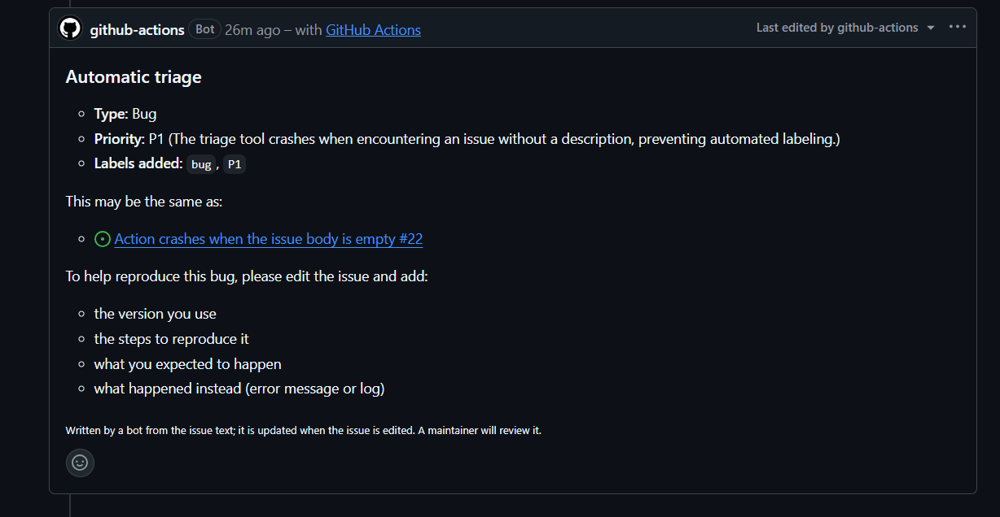
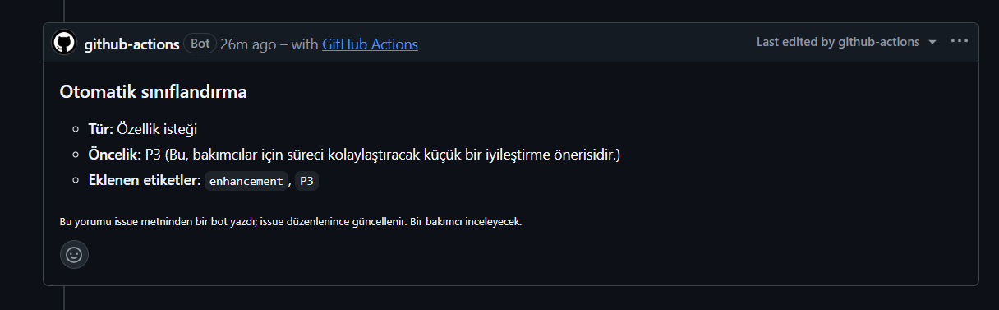

[English](README.md) | Türkçe

# Issue Triage Action

Yeni issue'ları bir LLM ile otomatik sınıflandıran GitHub Action. Her issue'yu reponun kendi etiketleriyle türüne ve önceliğine göre etiketler, olası tekrar issue'ları bulur, hata kaydında eksik bilgileri issue sahibinden ister ve hepsini tek bir kısa yorumda yazar. Ücretsiz bir Gemini API anahtarıyla çalışır; OpenAI uyumlu her sağlayıcıyla da kullanılabilir (Groq, OpenAI, yerel Ollama).

## Özellikler

- **Tür:** hata, özellik isteği, soru ya da belgelendirme.
- **Öncelik:** P0-P3 ve tek cümlelik gerekçe.
- **Sadece reponun kendi etiketleri:** Action hiç etiket açmaz. Tür ve öncelik, repoda zaten olan etiketlerle eşleştirilir (`bug`, `enhancement`, `Type: Bug`, `priority/P1` gibi yazılışların hepsi tanınır); model listeden uygun başka etiketleri de seçebilir.
- **Tekrar issue bulma:** Yeni issue, en son güncellenen 100 issue'yla (açık ve kapalı) embedding benzerliğiyle karşılaştırılır; model bunlardan yalnızca aynı sorunu anlatanları tutar. Embedding modeli yoksa son issue başlıklarına düşer.
- **Eksik bilgi:** Sürümü, tekrar oluşturma adımları, beklenen ya da gerçek sonucu olmayan hata kayıtlarında yorum bunların eklenmesini ister.
- **Tek yorum, hep güncel:** Issue düzenlenince yeni yorum eklenmez, aynı yorum güncellenir.
- **Issue'nun dilinde yorum:** Türkçe issue'ya Türkçe, diğerlerine İngilizce yorum yazılır.
- **Bakımcıya saygı:** Bir insanın etiketlediği issue atlanır. Action yalnızca kendi eklediği etiketleri kaldırır; bakımcı onun eklediği bir etiketi kaldırırsa o etiketi bir daha eklemez.
- **Issue akışını bloklamaz:** Sağlayıcı kesintisi ve kota sınırı çalıştırmayı uyarıyla bitirir; yalnızca yanlış ayar (geçersiz anahtar, model adı ya da girdi) kırmızıya çevirir.
- **Dry run:** Hiçbir şey yazmadan etiketleri ve yorumun tamamını günlükte gösterir.

## Ekran Görüntüleri

Bir hata kaydı: etiketler, öncelik, olası bir tekrar ve eksik bilgiler.



Türkçe bir özellik isteğine Türkçe yorum yazılır.



## Kullanılan Teknolojiler

| | |
|---|---|
| TypeScript, Node üzerinde JavaScript Action | Docker Action'ın aksine saniyeler içinde başlar, her işletim sisteminde çalışır |
| @actions/core, @actions/github | Girdiler, çıktılar, günlük ve kimlikli REST istemcisi |
| OpenAI uyumlu API, varsayılan Gemini | Ücretsiz katmanında sohbet ve embedding var; aynı istek başka sağlayıcılarda da çalışır |
| zod | Modelin JSON cevabını çalışma anında doğrular |
| esbuild | Action'ı tek bir `dist/index.js` dosyasına paketler |
| Vitest | Sahte GitHub ve model istemcileriyle birim ve uçtan uca testler |

## Kurulum ve Çalıştırma

1. [Google AI Studio](https://aistudio.google.com/apikey)'dan ücretsiz bir API anahtarı oluşturun.
2. Anahtarı repoya `GEMINI_API_KEY` adlı secret olarak ekleyin (Settings → Secrets and variables → Actions ya da `gh secret set GEMINI_API_KEY`).
3. `.github/workflows/triage.yml` dosyasını ekleyin:

```yaml
name: Issue triage

on:
  issues:
    types: [opened, edited, reopened]

permissions:
  contents: read
  issues: write

concurrency:
  group: triage-${{ github.event.issue.number }}

jobs:
  triage:
    runs-on: ubuntu-latest
    steps:
      - uses: MrcDprm/issue-triage-action@v1
        with:
          api-key: ${{ secrets.GEMINI_API_KEY }}
```

Önce hiçbir issue'ya dokunmadan denemek için `dry-run: true` ekleyin ve sonucu çalıştırma günlüğünde okuyun.

### Girdiler

| Girdi | Varsayılan | Açıklama |
|---|---|---|
| `api-key` | (zorunlu) | LLM sağlayıcısının API anahtarı. Secret'ta saklayın. |
| `base-url` | Gemini'nin OpenAI uyumlu adresi | OpenAI uyumlu API adresi. https olmalı (http yalnızca localhost için). |
| `model` | `gemini-3.1-flash-lite` | Issue'yu sınıflandıran sohbet modeli. |
| `embedding-model` | `gemini-embedding-001` | Tekrar bulma için embedding modeli. Sağlayıcıda yoksa boş bırakın. |
| `github-token` | `${{ github.token }}` | Issue'ları okumak, etiket ve yorum yazmak için token. |
| `max-candidates` | `5` | Modele olası tekrar olarak gösterilen benzer issue sayısı (0-20, 0 kapatır). |
| `similarity-threshold` | `0.75` | Tekrar adayı için en düşük kosinüs benzerliği (0-1). |
| `dry-run` | `false` | Issue'ya değil, yalnızca günlüğe yaz. |

### Çıktılar

`type`, `priority`, `labels` (virgülle ayrılmış) ve `duplicates` (virgülle ayrılmış issue numaraları); aynı işin sonraki adımları kullanabilir. Issue atlanırsa boştur.

### Diğer sağlayıcılar

```yaml
# Groq (embedding yok: tekrarlar issue başlıklarından bulunur)
with:
  api-key: ${{ secrets.GROQ_API_KEY }}
  base-url: https://api.groq.com/openai/v1
  model: <JSON şema çıktısı destekleyen bir Groq sohbet modeli>
  embedding-model: ''

# OpenAI
with:
  api-key: ${{ secrets.OPENAI_API_KEY }}
  base-url: https://api.openai.com/v1
  model: <bir OpenAI sohbet modeli>
  embedding-model: text-embedding-3-small
```

Yerel Ollama (`http://localhost:11434/v1`) kendi sunucunuzdaki (self-hosted) runner'da çalışır.

### Güvenlik ve gizlilik

- **Prompt injection:** Public bir repoda issue'yu herkes yazabilir. Issue modele talimatlardan ayrı, JSON verisi olarak gönderilir; model ne cevap verirse versin yalnızca şemadaki alanlar kullanılır: etiketler repoda var olmalı, tekrarlar Action'ın gönderdiği issue'lardan olmalı, öncelik ve tür sabit listelerdir.
- **Yorum şablondan üretilir.** Tek serbest metin modelin öncelik gerekçesidir; kaçışlanır, anmalar, issue referansları ve bağlantılar etkisizleştirilir: kimse etiketlenmez, hiçbir bağlantı tıklanamaz.
- **En az yetki:** İş akışı yalnızca `issues: write` ve `contents: read` ister, `pull_request_target` kullanmaz.
- **Anahtar** secret'ta kalır, günlüklerde maskelenir ve hata mesajlarından silinir.
- **Kota:** Issue metni gönderilmeden önce kırpılır; her issue en fazla bir sohbet ve bir-iki embedding isteğine mal olur.
- **Gizlilik:** Gemini'nin ücretsiz katmanında Google istekleri ürünlerini geliştirmek için kullanabilir. Gizli repolarda ücretli anahtar ya da başka bir sağlayıcı kullanın.

## Öğrendiklerim

- İlk GitHub Action'ımı yazdım ve nasıl paketlendiğini öğrendim: Action doğrudan `dist/index.js`'i çalıştırır; bu yüzden esbuild ile paketleyip çıktıyı commit'liyorum, `dist/` güncel değilse CI kırmızı oluyor.
- Modelin cevabını güvenilmez girdi olarak ele aldım. JSON şeması modeli yönlendiriyor, zod cevabı kontrol ediyor, kendi kodum da etiketleri ve tekrar numaralarını gerçekte var olanlarla yeniden süzüyor.
- Prompt injection'ın pratikte neye benzediğini öğrendim ve en kötü durumu test ettim: saldırgana uyan bir model bile yabancı etiket ekleyemiyor, birini anamıyor, bağlantı paylaşamıyor.
- Tekrar issue'ları bulmak için embedding ve kosinüs benzerliği kullandım; istekleri parçalamayı öğrendim (Gemini tek istekte en fazla 100 metin kabul ediyor).
- Uyarıyla geçmesi gereken hataları (kota, kesinti) kırmızı bitmesi gerekenlerden (yanlış anahtar ya da model adı) ayırdım. İlk sürümümün yanlış anahtarı sessizce geçirdiğini bir test yakaladı.
- Botu insanlara karşı saygılı tuttum: eklediği etiketleri kendi yorumundaki gizli bir satırda saklıyor; böylece yalnızca kendi etiketlerini kaldırıyor ve bakımcıyla etiket kavgasına girmiyor.
- GitHub'ı ve modeli dışarıdan bağımlılık olarak vererek akışı test edilebilir yaptım; Action'ı sahtelerle uçtan uca çalıştırıp her güvenlik korumasını bilerek bozdum ve bir testin kırıldığını gördüm.
